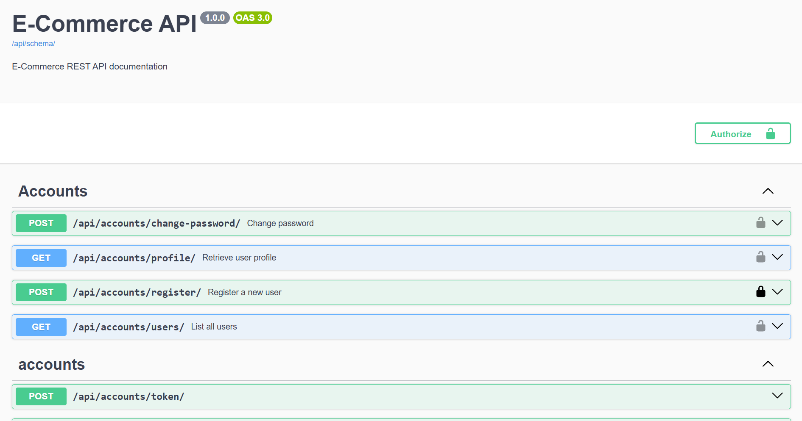
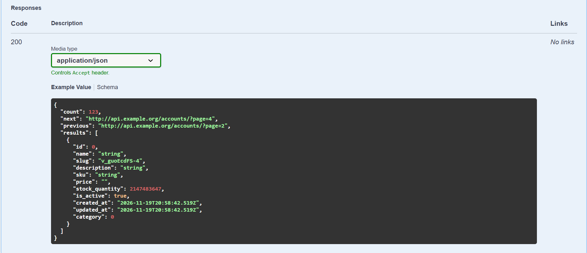

# 🛒 E-Commerce REST API

A deployed RESTful e-commerce backend built with **Django REST Framework** and **PostgreSQL**.

The API provides a backend system for user management, product catalogs, shopping carts, order processing, and online payments through Stripe.

**Live API:** [https://ecommerce-api-demo-mgj3.onrender.com](https://ecommerce-api-demo-mgj3.onrender.com)

**API Documentation:**
- [Swagger UI](https://ecommerce-api-demo-mgj3.onrender.com/api/docs/)
- [ReDoc](https://ecommerce-api-demo-mgj3.onrender.com/api/redoc/)
- [OpenAPI Schema](https://ecommerce-api-demo-mgj3.onrender.com/api/schema/)

---

## 📸 API Documentation Preview

Explore the API through its interactive documentation.

### Swagger API Documentation



### Products API Response



---

## ✨ Features

- Custom user model and user registration
- JWT authentication and token refresh
- Product and category management
- Shopping cart management
- Order creation and management
- Stripe Checkout integration
- Stripe webhook processing
- Role-based permissions and object ownership
- Product filtering, searching, and ordering
- API pagination
- Redis caching
- Celery background task configuration
- Automated testing
- Interactive API documentation
- Docker configuration
- GitHub Actions CI/CD
- Live deployment

---

## 🛠️ Technologies

| Technology | Purpose |
|---|---|
| Python | Programming language |
| Django | Backend framework |
| Django REST Framework | REST API development |
| PostgreSQL | Relational database |
| Redis | Caching and task broker |
| Celery | Background task processing |
| Simple JWT | Authentication |
| Stripe | Payment processing |
| drf-spectacular | OpenAPI documentation |
| Docker | Containerization |
| Git & GitHub | Version control |
| GitHub Actions | CI/CD |
| Render | Application hosting |
| Neon | Managed PostgreSQL |
| Upstash | Managed Redis |

---

## 🏗️ Project Architecture

The application is divided into independent Django applications, each responsible for a specific business domain.

```text
ecommerce_api/
│
├── accounts/       # User management and authentication
├── products/       # Products and categories
├── carts/          # Shopping cart functionality
├── orders/         # Order management
├── payments/       # Stripe payment integration
│
├── config/         # Project configuration
├── screenshots/    # README screenshots
│
├── compose.yaml
├── build.sh
├── requirements.txt
├── manage.py
└── README.md
```

---

## 📦 Application Modules

### 1. Accounts

- Custom user model
- User registration
- JWT authentication
- Login and token refresh
- Authentication and permission handling

### 2. Products

- Product and category models
- Serializers and validation
- CRUD API endpoints
- Staff-based permissions
- Filtering, searching, and ordering
- Pagination

### 3. Carts

- Shopping cart and cart item models
- Add products to cart
- Retrieve cart details
- Update cart items
- Remove cart items
- Calculate item subtotals and cart totals
- Serializer validation

### 4. Orders

- Order and order item models
- Create orders from shopping carts
- Order item snapshots
- Order management endpoints
- Order status management
- Customer ownership permissions
- Order validation

### 5. Payments

- Payment model and status management
- Stripe Checkout integration
- Secure checkout session creation
- Stripe webhook signature verification
- Successful payment processing
- Failed and expired payment handling
- Automatic order confirmation after successful payment
- Webhook event idempotency using Stripe event IDs

---

## 🔐 Authentication

The API uses **JSON Web Token (JWT)** authentication through Simple JWT.

Protected endpoints require an access token.

Include the token in the request header:

```http
Authorization: Bearer <your_access_token>
```

Authentication includes:

- User registration
- Login
- Access token generation
- Token refresh
- Authenticated API access
- Permission-based access control

---

## 💳 Payment Integration

Stripe Checkout is used to process online payments.

### Payment Endpoints

| Method | Endpoint | Description |
|---|---|---|
| POST | `/api/payments/` | Create a payment and Stripe Checkout session |
| POST | `/api/payments/webhook/` | Receive Stripe webhook events |

Supported webhook events:

- `checkout.session.completed`
- `checkout.session.expired`
- `payment_intent.payment_failed`

Webhook signatures are verified, and processed event IDs are stored to prevent duplicate processing.

---

## 📚 API Documentation

API documentation is generated using **drf-spectacular** and the OpenAPI specification.

| Documentation | Endpoint |
|---|---|
| Swagger UI | `/api/docs/` |
| ReDoc | `/api/redoc/` |
| OpenAPI Schema | `/api/schema/` |

The documentation provides:

- Available API endpoints
- HTTP methods
- Request parameters and body formats
- Response schemas
- Authentication requirements
- Interactive API testing through Swagger UI

---

## 🗄️ Database

PostgreSQL is used as the primary relational database.

The project uses Django ORM for database operations and migrations.

The main application domains include:

- Users
- Products
- Categories
- Shopping carts
- Cart items
- Orders
- Order items
- Payments

---

## ⚙️ Local Installation

### Prerequisites

- Python 3.14+
- PostgreSQL
- Redis
- Git

### 1. Clone the repository

```bash
git clone https://github.com/segnig123/ecommerce-api.git

cd ecommerce-api
```

### 2. Create a virtual environment

```bash
python -m venv .venv
```

Activate it:

**Windows PowerShell**

```powershell
.venv\Scripts\Activate.ps1
```

**Linux/macOS**

```bash
source .venv/bin/activate
```

### 3. Install dependencies

```bash
pip install -r requirements.txt
```

### 4. Configure environment variables

Create a `.env` file in the project root.

Configure the required settings for your local environment:

```env
SECRET_KEY=your_secret_key
DEBUG=True

DB_NAME=your_database
DB_USER=your_database_user
DB_PASSWORD=your_database_password
DB_HOST=localhost
DB_PORT=5432

REDIS_CACHE_URL=your_redis_url

CELERY_BROKER_URL=your_redis_url
CELERY_RESULT_BACKEND=your_redis_url

STRIPE_SECRET_KEY=your_stripe_secret_key
STRIPE_WEBHOOK_SECRET=your_stripe_webhook_secret
```

Configure any additional environment variables required by your Django settings.

**Never commit your `.env` file or secret credentials to GitHub.**

### 5. Apply database migrations

```bash
python manage.py migrate
```

### 6. Create a superuser

```bash
python manage.py createsuperuser
```

### 7. Start the development server

```bash
python manage.py runserver
```

The API will be available at:

```text
http://127.0.0.1:8000/
```

---

## 🧪 Automated Testing

Automated tests cover the main application components.

Testing includes:

- Model behavior and database constraints
- Serializer validation
- API endpoints and responses
- Authentication and permissions
- Object ownership
- Payment processing
- Stripe webhook handling

Run the test suite:

```bash
python manage.py test
```

---

## 🐳 Docker

Docker configuration is included to support containerized development.

The project includes:

```text
compose.yaml
.env.docker
```

Start the configured services:

```bash
docker compose up --build
```

Stop the services:

```bash
docker compose down
```

---

## 🔄 CI/CD

GitHub Actions is used to automate project checks.

The configured workflow includes:

- Automated Django system checks
- Migration validation

The project uses Git and GitHub for version control and collaborative development practices.

---

## ☁️ Deployment

The application is deployed using a free-tier hosting architecture.

| Component | Service |
|---|---|
| Web application | Render |
| PostgreSQL database | Neon |
| Redis | Upstash |
| Source control | GitHub |
| CI/CD | GitHub Actions |

The deployment uses environment variables for sensitive configuration.

The application also uses Gunicorn and WhiteNoise for application serving and static file handling.

**Live application:** [https://ecommerce-api-demo-mgj3.onrender.com](https://ecommerce-api-demo-mgj3.onrender.com)

---

## 🚀 Development Progress

| Component | Status |
|---|---|
| Project Setup | Completed |
| Accounts | Completed |
| Products | Completed |
| Carts | Completed |
| Orders | Completed |
| Payments | Completed |
| API Documentation | Completed |
| Automated Testing | Implemented |
| Docker Configuration | Completed |
| CI/CD | Implemented |
| Deployment | Completed |

---

## 🔒 Security

- Environment-based secret management
- JWT authentication
- Permission-based access control
- Stripe webhook signature verification
- HTTPS deployment
- Production security configuration

---

## 👨‍💻 Author

**Segni**

Backend Developer | Python & Django REST Framework

GitHub: [@segnig123](https://github.com/segnig123)